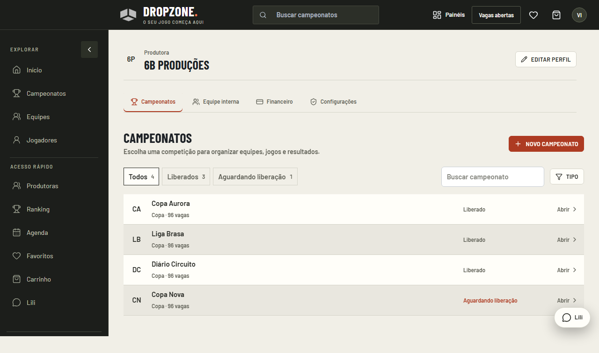
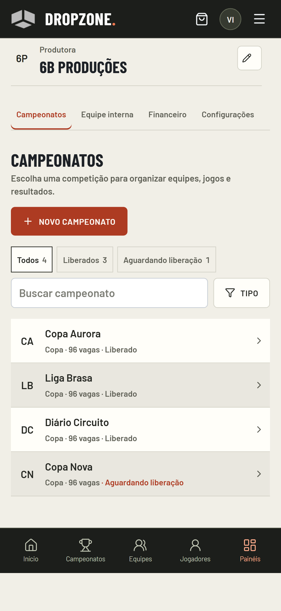

# Entrada e operação da produtora

A produtora agora abre a lista dos seus campeonatos. A tela anterior ainda empilhava identidade de conta, título do painel, callout de criação, métricas e ajuda; esse fluxo de entrada foi retirado.

## Hierarquia

1. Identidade compacta da produtora e navegação de gestão: Campeonatos, Equipe interna, Financeiro e Configurações, conforme as permissões.
2. Lista de campeonatos com busca, filtros por situação/tipo e Novo campeonato. Cada linha identifica a competição, suas vagas e a liberação, com ação Abrir.
3. Campeonato aberto em uma área separada, com Voltar aos campeonatos e seletor de outra competição. A lista completa não permanece acima do editor.
4. Ferramentas em menu lateral no PC; no celular, seletor identificado por Ferramenta do campeonato. Organização, fases/grupos, equipes, elencos, jogos/quedas, pontuador, tabelas e inscrições seguem utilizando os serviços existentes.
5. Regras de pontuação e Regras avançadas permanecem junto das ferramentas. Edição de perfil da produtora em modal.

A navegação, cores, fontes e largura globais são as mesmas do restante da plataforma. A identidade da produtora não aparece repetida na faixa de conta. Troca de produtora continua disponível quando há mais de um contexto. Os vínculos, inscrições, pagamentos, permissões, transferência de perfis e cálculo de resultados foram preservados; não há migração de banco nesta revisão.

## Navegação e proteção de trabalho

A URL acompanha a competição e a ferramenta selecionadas. Voltar à lista limpa o campeonato da URL para que uma atualização de dados não reabra o editor. Os avisos de rascunho de pontuação continuam cobrindo trocas de ferramenta, competição e seção; gravação em andamento impede sair.

## Verificação

O cenário de entrada confere que a lista é visível na primeira tela, que o callout anterior não existe mais, que as linhas são compactas, e que busca/filtros, abertura, retorno e edição de perfil funcionam. A comparação entre painel e catálogo continua conferindo a mesma estrutura global. Os testes do pontuador preservam FALT, rascunhos e IDs de participação. Capturas usam dados controlados; não representam operações em campeonatos reais.

Esta composição substitui a entrada e a navegação descritas em PRODUTORA_FLUXO_ESTUDIO_20261103.md. O funcionamento de campeonatos e a correção de pontuação daquela revisão continuam válidos.

Build completo, tipos, lint, regressões R06–R12/R20–R24 e contrato da identidade aprovados. Os 26 cenários de experiência passaram em produção local; a entrada foi repetida em PC/mobile após o ajuste final da densidade e dos quatro destinos da gestão.

